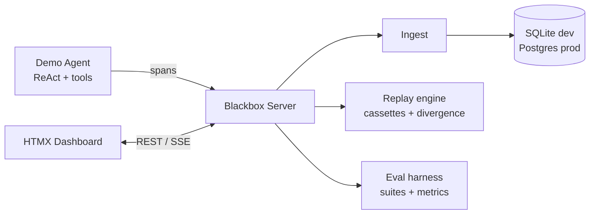

# Blackbox

**Flight recorder for AI agents.** Instrument agent runs as distributed traces, replay any run deterministically, and gate prompt/model changes with an eval harness.

> Status: under construction — milestone **M0 (scaffold)** complete. See [roadmap](#roadmap).

## Why

Production agents fail in ways logs can't explain: a tool returned stale data at step 4, the model looped at step 7, cost spiked because of a retry storm. Blackbox records every LLM call, tool call, and handoff as trace spans, lets you replay the exact run to reproduce the failure, and runs golden eval suites in CI so regressions never ship.

## Architecture



One Go binary (server) + one demo agent. Stdlib-first: `net/http`, `html/template`, HTMX — no JS build step.

## Quickstart

Requires Go 1.27+.

```sh
make build
./bin/blackbox serve
```

```sh
curl localhost:8080/healthz   # ok
curl localhost:8080/          # {"name":"blackbox","version":"dev",...}
```

In another terminal, run the demo research agent (no API keys needed — it uses a deterministic mock LLM):

```sh
./bin/demoagent
# Q: What is the capital of France and its population?
# A: Based on my research: Paris is the capital of France. ...
#   steps=2 trace=a3cb0c14ffee54192545006473606e2d
```

Every run lands as a trace in the database. Real providers work too:
`./bin/demoagent -provider openai` (needs `OPENAI_API_KEY`) or `-provider anthropic`.

Open <http://localhost:8080/ui/> for the dashboard: trace list with filters,
waterfall span view, and a payload inspector for every LLM call and tool call.
A JSON API is available at `/v1/traces` and `/v1/traces/{id}`.

Replay any recorded run deterministically — every LLM call and tool call is
served from cassettes extracted from the trace, and any prompt/tool/input
change is reported as a divergence at the exact step it happens:

```sh
./bin/blackbox replay <trace-id>
# Replaying trace 82d4a9b56229 (6 spans, 3 cassettes)
# Cassette hits: 3, divergences: 0
# Replay matches the original run.
```

Run golden eval suites and gate on regressions. Suites are plain YAML with
assertions on the answer, tools used, steps, cost, and latency:

```yaml
suite: research-basics
cases:
  - name: arithmetic
    question: "What is 123 * 456?"
    expect:
      output_contains: ["56088"]
      tools_called: ["calculator"]
      max_steps: 3
      max_cost_usd: 0.01
```

```sh
./bin/blackbox eval run -dir evals -save baseline.json
# Suite research-basics: 4/4 cases passed (cost $0.001182, 1ms)
#   PASS  arithmetic  2 steps  $0.000247  d878c37f01157dc2

./bin/blackbox eval run -dir evals -baseline baseline.json
# fails non-zero if a case that passed in the baseline now regresses
```

Every eval case is also recorded as a trace (tagged `blackbox.eval_suite` /
`blackbox.eval_case`), so failing cases can be inspected and replayed in
the dashboard.

Docker:

```sh
docker compose -f deploy/docker-compose.yml up --build
```

## Roadmap

- [x] **M0** — Scaffold: module, CI, Docker, Makefile
- [x] **M1** — Tracing core: span model, tracer SDK, ingest endpoint, SQLite store
- [x] **M2** — Demo agent: ReAct research agent with mock LLM + real provider adapters
- [x] **M3** — Trace UI: list, waterfall detail, span payload inspector (HTMX)
- [x] **M4** — Replay: cassette recorder, deterministic replay, divergence report
- [x] **M5** — Eval harness: YAML suites, assertions, metrics, baseline regression gate
- [ ] **M6** — Eval UI: suite runs, trend charts, A/B trace diff
- [ ] **M7** — Prod mode: Postgres, docker compose stack, live SSE streaming
- [ ] **M8** — Polish: README GIF, seeded demo data, ingest benchmark, ADRs

## Layout

```
cmd/blackbox/      server binary (serve, ping, replay, eval, version)
cmd/demoagent/     demo ReAct research agent
pkg/span/          span model + agent semantic conventions (wire format)
pkg/tracer/        public Go SDK for agent authors
pkg/llm/           LLM provider interface: mock, OpenAI, Anthropic
internal/          demoagent, ingest, store, replay, eval, api, ui
web/               embedded static assets
evals/             golden eval datasets (YAML)
deploy/            docker compose
```

## Instrumenting an agent

```go
tr := tracer.New(tracer.Config{
    Endpoint:    "http://localhost:8080/v1/spans",
    ServiceName: "research-agent",
})
defer tr.Shutdown(context.Background())

ctx, run := tr.StartRun(ctx, "research-agent")
defer run.End()

_, llm := tr.StartLLMCall(ctx, "plan")
llm.SetAttribute(span.AttrModel, "mock-1")
_ = llm.SetOutput("I should search for the population.")
llm.End()
```

Spans are batched and exported to `POST /v1/spans`. Payloads larger than 256 KiB are truncated and flagged (`blackbox.truncated`).

## Development

```sh
make test        # go test -race ./...
make check-fmt   # fail if gofmt needed
make lint        # golangci-lint if installed, else go vet
make ci          # check-fmt + vet + test + build
```

## License

MIT
