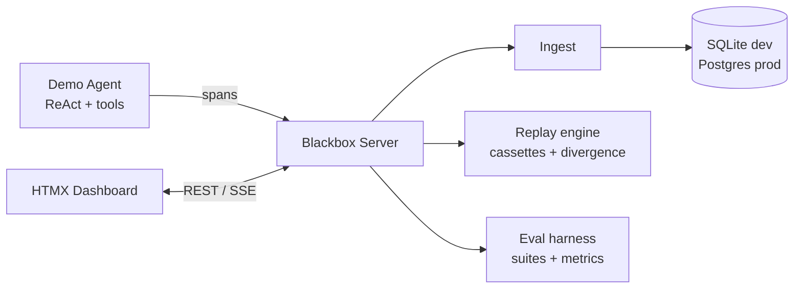

# Blackbox

**Flight recorder for AI agents.** Instrument agent runs as distributed traces, replay any run deterministically, and gate prompt/model changes with an eval harness.

> Status: under construction — milestone **M0 (scaffold)** complete. See [roadmap](#roadmap).

## Why

Production agents fail in ways logs can't explain: a tool returned stale data at step 4, the model looped at step 7, cost spiked because of a retry storm. Blackbox records every LLM call, tool call, and handoff as trace spans, lets you replay the exact run to reproduce the failure, and runs golden eval suites in CI so regressions never ship.

## Architecture



One Go binary (server) + one demo agent. Stdlib-first: `net/http`, `html/template`, HTMX — no JS build step.

## Quickstart

Requires Go 1.27+.

```sh
make build
./bin/blackbox serve
```

```sh
curl localhost:8080/healthz   # ok
curl localhost:8080/          # {"name":"blackbox","version":"dev",...}
```

Docker:

```sh
docker compose -f deploy/docker-compose.yml up --build
```

## Roadmap

- [x] **M0** — Scaffold: module, CI, Docker, Makefile
- [ ] **M1** — Tracing core: span model, tracer SDK, ingest endpoint, SQLite store
- [ ] **M2** — Demo agent: ReAct research agent with mock LLM + real provider adapters
- [ ] **M3** — Trace UI: list, waterfall detail, span payload inspector (HTMX)
- [ ] **M4** — Replay: cassette recorder, deterministic replay, divergence report
- [ ] **M5** — Eval harness: YAML suites, assertions, metrics, baseline regression gate
- [ ] **M6** — Eval UI: suite runs, trend charts, A/B trace diff
- [ ] **M7** — Prod mode: Postgres, docker compose stack, live SSE streaming
- [ ] **M8** — Polish: README GIF, seeded demo data, ingest benchmark, ADRs

## Layout

```
cmd/blackbox/      server binary (serve, ping, version)
cmd/demoagent/     demo ReAct research agent
pkg/tracer/        public Go SDK for agent authors
pkg/llm/           LLM provider interface: mock, openai, anthropic
internal/          span model, ingest, store, replay, eval, api, ui
web/               embedded static assets
evals/             golden eval datasets (YAML)
deploy/            docker compose
```

## Development

```sh
make test        # go test -race ./...
make check-fmt   # fail if gofmt needed
make lint        # golangci-lint if installed, else go vet
make ci          # check-fmt + vet + test + build
```

## License

MIT
